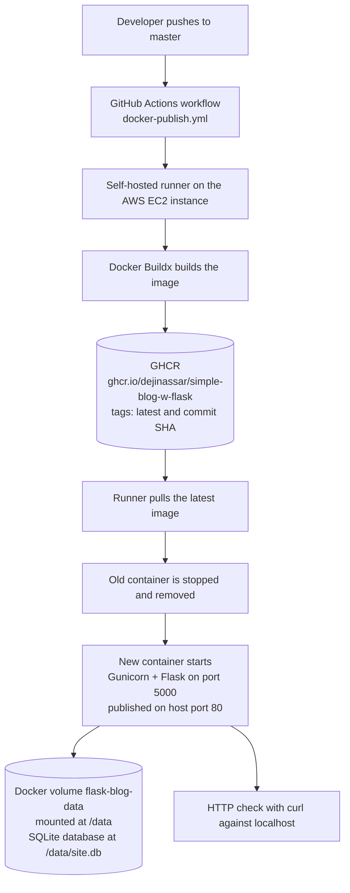

# Simple-Blog-w-Flask
This repo contains code for a simple flask-blog application using Flask and it's libraries for web development.

This project is a template for a simple blog website with User Login/Signup, Post CRUD operations on a web interface.

The project is built using HTML, CSS, Bootstrap, Python, Flask, SQL and Jinja Logics.

In addition to the application itself, this repository now includes a containerized deployment and CI/CD pipeline. The app is packaged with Docker and served by Gunicorn. A GitHub Actions workflow builds the image, publishes it to GitHub Container Registry (GHCR), and deploys the updated container to a single AWS EC2 instance in the `eu-north-1` region. A push to the `master` branch triggers the whole process. This has been tested end to end: a change to the About page was pushed, the workflow finished with a green check, and the updated page was confirmed on the live application.

## Technology Stack
**Application**
* Python
* Flask
* HTML, CSS and Bootstrap
* Jinja templates
* SQLAlchemy (via Flask-SQLAlchemy)
* SQLite

**DevOps and Cloud**
* Docker
* Gunicorn (WSGI server inside the container)
* GitHub Actions (CI/CD, using a self-hosted runner)
* GitHub Container Registry (GHCR)
* AWS EC2 (`eu-north-1`)

## Architecture
The diagram below shows how a code change travels from a `git push` to the running application.

## Steps To Reproduce:
For project to run make sure you have a working version of Python 3.X (3.7) being used in the project.
Clone the repoto your local system and then after opening the terminal in the repo directory run the following command to install the requirements.

    pip install -r requirements.txt
        or
    pip3 install -r requirements.txt

Then to run the project open terminal and run the following command:

    python app.py

To access the website just browse the following on your browser:
    
    localhost:5000

The application reads its settings from environment variables, and each one has a default for local use: `SECRET_KEY`, `DATABASE_URI` (defaults to `sqlite:///site.db`), `EMAIL_ADDRESS` and `EMAIL_PASSWORD` (used for password-reset emails). The default `SECRET_KEY` is for local development only and must not be used on a public deployment. The application does not create database tables on startup, so the database needs its tables to exist before pages that read users or posts will work.

The Docker image is built from Python 3.10 (see the Docker section below), while the original instructions above refer to Python 3.7.

## Docker
The application is containerized so the same image can be run locally and on the server.

* **`Dockerfile`**: starts from `python:3.10-slim`, installs the system libraries needed to build some Python dependencies, installs `requirements.txt`, copies the project into `/app`, exposes port `5000`, and starts the app with Gunicorn (`gunicorn --bind 0.0.0.0:5000 --workers 2 app:app`).
* **`.dockerignore`**: keeps files that should not be baked into the image out of the build context: `.git`, local virtual environments (`venv/`, `venv310/`), Python bytecode caches, `.env` files, and the local `flaskblog/site.db` database.

Build and run the image locally:

    docker build -t simple-blog-w-flask .
    docker run --rm -p 5000:5000 -e SECRET_KEY="replace-with-your-own-random-value" simple-blog-w-flask

Then browse to `localhost:5000`. These commands match the `Dockerfile` in this repository. As noted above, the app does not create its own tables, so a brand-new empty database will not serve pages that read from it.

## Container Registry
The image is published to GitHub Container Registry as:

    ghcr.io/dejinassar/simple-blog-w-flask

Each workflow run pushes two tags:

* **`latest`**: a moving tag that always points to the most recent build from `master`. The deployment step pulls this tag.
* **Commit SHA** (the full `github.sha` of the commit that triggered the run): an identifier for one specific build, which makes it possible to trace an image back to the exact commit it was built from.

## CI/CD Workflow
The workflow is defined in `.github/workflows/docker-publish.yml` (named "Build, Publish and Deploy Docker Image"). It runs on every push to `master` and can also be started manually with `workflow_dispatch`. It runs as a single job on a **self-hosted GitHub Actions runner** installed on the EC2 instance, so the build and the deployment both happen on the server. The workflow's permissions are limited to reading repository contents and writing packages.

1. **Checkout**: the repository is checked out on the runner.
2. **Build setup and registry login**: Docker Buildx is set up, and the runner logs in to GHCR with the workflow's built-in `GITHUB_TOKEN`.
3. **Build and publish**: the image is built from the `Dockerfile` and pushed to GHCR with the `latest` and commit-SHA tags.
4. **Deploy**: the runner pulls `latest`, reads the `SECRET_KEY` from the currently running container so the same key is reused, stops and removes the old `flask-blog-container`, and starts a new container from the updated image. The new container is started with `--restart unless-stopped`, publishes host port `80` to container port `5000`, and mounts the `flask-blog-data` volume.
5. **Response check**: after a 5 second wait, the workflow runs `curl --fail` against `http://localhost/`. If the application does not return a successful HTTP response, the step fails and the workflow run is marked as failed.

The deploy script replaces the container by stopping the old one before starting the new one, so there is a short interruption while this happens. The workflow does not roll back automatically if the new container fails the response check.

## Persistent Data
The application stores its data in SQLite. In the deployed container, `DATABASE_URI` points to `sqlite:////data/site.db`, and `/data` is backed by a Docker named volume called `flask-blog-data`.

Because the database file lives in the volume and not in the container's own filesystem, stopping, removing and recreating the application container during a deployment does not delete it. The new container mounts the same volume and finds the existing database.

**A Docker volume is not a backup.** It lives on the same EC2 instance and its storage, so it does not protect against deleting the volume, losing or terminating the instance, disk failure, or data corruption. Separate, tested backups are needed for that (see Limitations and Future Improvements).

## Configuration and Security
* **Environment-based configuration**: the application takes `SECRET_KEY`, `DATABASE_URI`, `EMAIL_ADDRESS` and `EMAIL_PASSWORD` from environment variables (see `flaskblog/secrets.py`), so no credentials need to be stored in the code. The deployment step passes only `DATABASE_URI` and `SECRET_KEY` to the container. The email variables are not set by the workflow as written, so email-based password reset is not configured in the deployed container.
* **Secret handling**: the application `SECRET_KEY` is not stored in the repository or the workflow file. The deploy step copies it from the currently running container each time. Because of this, a container with a `SECRET_KEY` must already exist on the server before the workflow can deploy. `.env` files are excluded by both `.gitignore` and `.dockerignore`. Registry login uses the temporary `GITHUB_TOKEN` provided by GitHub Actions.
* **Protect credentials**: never commit secrets, private keys, tokens or `.env` files, and never paste them into issues, logs or screenshots. If a credential is ever exposed, rotate it immediately.
* **SSH access**: SSH access to the server should be restricted in the EC2 security group to trusted addresses only, and key-based login should be used. No SSH details are published in this repository.
* **Exposed ports**: the application is published on HTTP port `80` of the host. Only the ports that are needed (HTTP, and SSH from trusted addresses) should be open in the security group. The repository does not configure HTTPS.

## Snapshots:
### Home Page

### Registration Page

### Login Page

### Home Page After Login

### Pagination on various pages

### Account Page

### New Post Page

### Home Page after Post

### Posts By User Page

### Delete Post Page

### Update Post Page

### Forgot Password Page

### Reset Password Page

### Page Responsiveness

### About Page

## Operations and Cost Management
* The EC2 instance can be stopped when it is not needed. While it is stopped, the website is offline and the self-hosted GitHub Actions runner is offline too, so pushes to `master` cannot be built or deployed until the instance is running again.
* Stopping the instance does not stop every AWS charge. Attached EBS storage and some other resources can still be billed, so review the AWS billing console and current pricing to confirm what applies to your account.
* When an EC2 instance is stopped and started again, its public IPv4 address can change, so any address you have saved or shared may stop working.
* After a restart, check that the runner is online in the repository's GitHub Actions settings and that the application responds before relying on the pipeline.

## Limitations and Future Improvements
**Completed**
* The application is containerized with Docker and served with Gunicorn.
* A GitHub Actions workflow builds the image and publishes it to GHCR with `latest` and commit-SHA tags.
* The workflow deploys the updated container to AWS EC2 and checks the HTTP response afterwards.
* The SQLite database is stored in the `flask-blog-data` Docker volume, outside the application container.
* Automatic deployment has been verified: a pushed change to the About page passed the workflow and appeared on the live application.

**Outstanding**
* Make the self-hosted runner persistent across instance reboots (not verified).
* Set up and test database backups and restoration. No backups are configured in this repository.
* Improve monitoring and alerting.
* Further security hardening, such as HTTPS, tighter network rules and a review of the pinned dependencies in `requirements.txt` (some are old releases, and some are development tools that the app does not appear to need).
* Add automated tests to the workflow. It currently builds, publishes and deploys without running a test step.
* Reduce deployment downtime and add a rollback process. The current deployment replaces the container in place and has no automatic rollback.
* Automate database setup and schema changes. The application does not create its tables on startup.
* Remove the need for an existing container to supply `SECRET_KEY` on the first deployment.

This is a small single-server deployment and should not be treated as production-ready.

## Acknowledgements:
I'd like to express my greatest gratitude towards [Corey Schafer](https://github.com/CoreyMSchafer) for his amazing teaching efforts and flask playlist.
For the website I've used the following resources:
* ***Icons***: [FlatIcons](https://www.flaticon.com/)
* ***Fonts***: [GoogleFonts](https://fonts.google.com/)
* ***Bootstrap***: [Bootstrap](https://getbootstrap.com/)
* ***External Packages***: [PyPI](https://pypi.org/)

## Project Maintainer
The Flask blog application was created by Harshit Saraswat, as credited in the application's source and About page, and it follows Corey Schafer's Flask tutorial series (see Inspiration and Acknowledgements above). The Docker containerization, GitHub Actions CI/CD pipeline and AWS EC2 deployment described in this README are maintained by [dejinassar](https://github.com/dejinassar).
